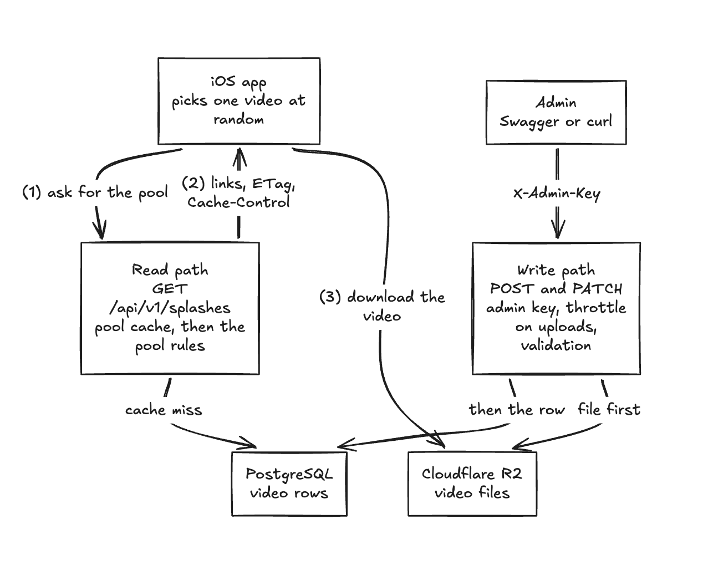

# Stroll splash backend

A backend that tells the iOS app which splash videos it may play. The list changes without an app release, and an event video such as Christmas replaces the normal rotation for a time window. Java 21, Spring Boot, PostgreSQL and Cloudflare R2 (S3-compatible file storage). It is backend only. The brief says that is complete, so there is no Swift client.

## How I read the brief

- The splash plays at launch, maybe before the network is ready. So the app must never wait on this call.
- A CDN (content delivery network, which keeps copies of files near users) fronts the API and storage. Production would use a custom domain, not the `r2.dev` address (R2's free test address).
- "Random rotation" means the app picks one video from a pool at each launch.
- An event replaces the rotation for its window. I took "a new splash video for that duration" literally.
- The admin API is my assumption for how the set changes without a release.
- One backend instance. Event windows are UTC.

## How it works



Left: the app reads. Right: an admin writes. The backend never serves video files. The app downloads them from R2.

The backend returns a pool, not a single pick. A pool is the same for every user, so the app and a CDN can cache it, and the server needs no randomness and no idea who is asking. The rules:

- Only active videos count.
- If an event is live (from its start up to, not including, its end), only live events are returned. Otherwise the standard videos are.
- A pinned video (an admin's "play this one") narrows the pool inside its tier. A pin never beats a live event.
- An event without both times is never eligible. An empty pool is valid, and the app then plays the video bundled in it.

I did not build or test the app side. I expect it to use a short timeout, play from its local cache, fall back to the bundled video, and check a download's checksum (explained below) before keeping it.

## Speed

- **Cache in memory.** The active rows sit in a Caffeine cache for 5 minutes (the TTL, or time to live), so a hit runs no database query. Every PATCH clears it. An upload does not, because a new video is inactive. The tier is worked out on each request, so an event starts and ends at its exact second.
- **`Cache-Control: max-age=300, public`** lets the app or a CDN reuse its copy for 300 seconds without calling me.
- **The ETag** is a short code that stands for the current pool, like a version stamp. The server sends it with every response. After the 300 seconds the app sends the stamp back and asks "has this changed?" If not, the server answers `304 Not Modified` with no body, a tiny reply instead of the full list. The code is calculated (with SHA-256) from everything the app would see, URLs included. So it changes whenever the pool does, and when the CDN domain does. The saving is modest, because the payload is small: 1,482 bytes against 164 for a `304`. It matters most behind a CDN.
- **The cost.** A kill switch or an event boundary can take up to 300 seconds to reach apps holding a fresh copy.
- **Numbers.** On my laptop against local Postgres, with no network, a cache hit had a median of 0.49 ms and a miss with one query 1.82 ms. I have not measured behind a CDN or under load.

## Decisions

| Decision | What I chose | What I dropped | Why |
|---|---|---|---|
| Pool or pick | Return a pool | Pick on the server | The same for everyone, so it caches. |
| Cache | In-process Caffeine | Redis | A network hop to save a cheap query. |
| Upload path | Through the backend | Presigned URLs (the app uploads straight to storage) | A splash is a few MB, and the server can calculate the checksum from what it receives. |
| Hiding a video | An `active` flag | A DELETE endpoint | Reversible, with no orphaned files. |
| Admin access | One static key | Per-admin login and audit trail | A small internal tool. See below. |
| Schema | `ddl-auto=update` and a seeder (loads the eight starting rows) | Flyway migrations | One table. Production would migrate. |
| Events | They replace the rotation. Overlapping events rotate together. | They join it, or a priority column | The simplest rule that matches the brief. |
| Stored location | The object key | The full URL | A new bucket or CDN domain is one setting and moves no data. |
| PATCH | `null` or "left out" means no change. Unknown fields and an empty body are rejected. | Silent acceptance | A typo like `pined` would otherwise change nothing without a word. |
| After upload | The video is inactive | Switching on automatically | An upload cannot reach the app by accident. |
| Upload guards | The key is checked before the body is read. A byte check on the file. A throttle of 10 uploads a minute, counted after the key check. | Per-IP limits, a rate-limit library | One shared key and one instance, so one counter is enough. |

**Deliberately not built:** impression logging (a batched POST from the app into per-video daily counters would be the design), regional or per-user targeting, timezone-local events, per-admin identity, DELETE and file replacement (upload a new video and switch the old one off), carousel order or weights, video duration metadata, rate limiting beyond uploads, cache sharing across instances, and the Swift client.

**Checksum.** A checksum is a short code calculated from a file's contents. Change one byte and the code changes. At upload the server calculates it (with SHA-256) and stores it with the size. The app calculates the code for what it downloaded and keeps the file only if the two match. If they differ, the download was cut off or damaged, so a broken file never becomes a splash. I use my own code, not R2's ETag, because what R2's code means depends on how a file was uploaded.

**One static admin key.** The `X-Admin-Key` header is checked against `ADMIN_API_KEY`. I left out login and an audit trail because the brief does not stress security and this is a small internal tool. The cost is no record of who changed what, and one shared key to rotate. Within that choice, the key is compared in constant time, never logged, and the app refuses to start if it is blank.

## API

Swagger UI documents every endpoint at `http://localhost:8080/docs`, and its Authorize button takes the admin key.

| Endpoint | Auth | Purpose |
|---|---|---|
| `GET /api/v1/splashes` | none | The pool. `200`, or `304` when unchanged. |
| `GET /api/v1/admin/splashes` | admin key | Every video, newest first, in pages (`page` from 0, `size` 1 to 100, default 20). The total is in the `X-Total-Count` header. |
| `POST /api/v1/admin/splashes` | admin key | Upload an mp4 (a multipart request: a file plus text fields). Returns `201`, inactive until switched on. |
| `PATCH /api/v1/admin/splashes/{id}` | admin key | Partial update of one video. |

Every error has the same three fields: `message`, `error` and `statusCode`. Validation problems are `400` and several are joined into one message. A wrong or missing key is `401`, a file over the size cap is `413`, more than 10 uploads a minute is `429`, and a storage failure is `500`.

## Data model

One table, `splash_video`: `id`, `title`, `kind` (`STANDARD` or `EVENT`), `object_key`, `checksum`, `size_bytes`, `active`, `pinned`, `starts_at`, `ends_at`, `created_at`, `updated_at`. The public URL is `storage.public-url` plus `object_key`.

## Running it

You need JDK 21 and Docker, which runs only Postgres.

```bash
cp .env.example .env
docker compose up -d
set -a; source .env; set +a
./mvnw spring-boot:run
```

The app does not read `.env` by itself, which is why the third line exports it into the shell. `.env.example` lists every setting with a dummy value. The app will not start without `DB_URL`, `DB_USERNAME`, `DB_PASSWORD`, `ADMIN_API_KEY`, `STORAGE_ACCESS_KEY_ID`, `STORAGE_SECRET_ACCESS_KEY`, `STORAGE_BUCKET_NAME` and `STORAGE_PUBLIC_URL`. The rest have defaults, including `SPLASH_UPLOAD_MAX_SIZE` and `SPLASH_UPLOAD_MAX_PER_MINUTE`.

The seeded rows point at real video files, so pick one way to set up storage:

- **The `.env` I send you.** Put it in the repo root, skip the `cp` line, and run the rest. I will rotate its token after the review.
- **Your own bucket.** Upload the eight `.mp4` files in `video-assets/splashes/` with the keys in `manifest.json`, make the bucket publicly readable, and set the storage values to yours. Set `STORAGE_ENDPOINT` for R2 or similar, and leave it empty for AWS S3.
- **Read only, no credentials.** Set `STORAGE_PUBLIC_URL` to the public address I send you and any text in the other storage values. The videos play from my bucket and uploads fail with a `500`.

On first run the seeder loads eight rows: six standard videos, Halloween 2026 and Christmas 2026. When I wrote this, on 4 November 2026, Halloween was over and Christmas was ahead, so `GET /api/v1/splashes` returns the six standard videos. To see an event take over, PATCH Christmas in Swagger UI with a `startsAt` an hour ago and an `endsAt` an hour ahead, then call the endpoint again: only Christmas comes back. The demo videos are mine, made from the recording in the brief, as stand-ins for the design team's assets.

## How it was checked

There are 195 tests, and none need a database, Docker or network. I also ran a scripted pass of about 150 checks against real Postgres and a real R2 bucket, on a fresh database and the final code. It covered the `304`, events and pins, every validation message, real uploads, paging, the byte check, the upload throttle, a wrong key with a large file, restart behaviour and a storage failure. I have not checked it behind a CDN, under load, with several instances, or on a phone.

## Limits I accept

- Two admins editing at once means the last write wins.
- If the database save fails after an upload, an orphan file stays in the bucket. The API has no delete.
- The cache and the throttle live in one process. With several instances, caches catch up when the TTL ends.
- A change can take up to 300 seconds to reach apps holding a fresh copy.
- The upload check looks at the label and the first bytes, and does not prove the file plays. The upload is read into memory, so the 10 MB cap matters.
- Nothing limits requests other than uploads, and the key check has no lockout. Use a long random key.
